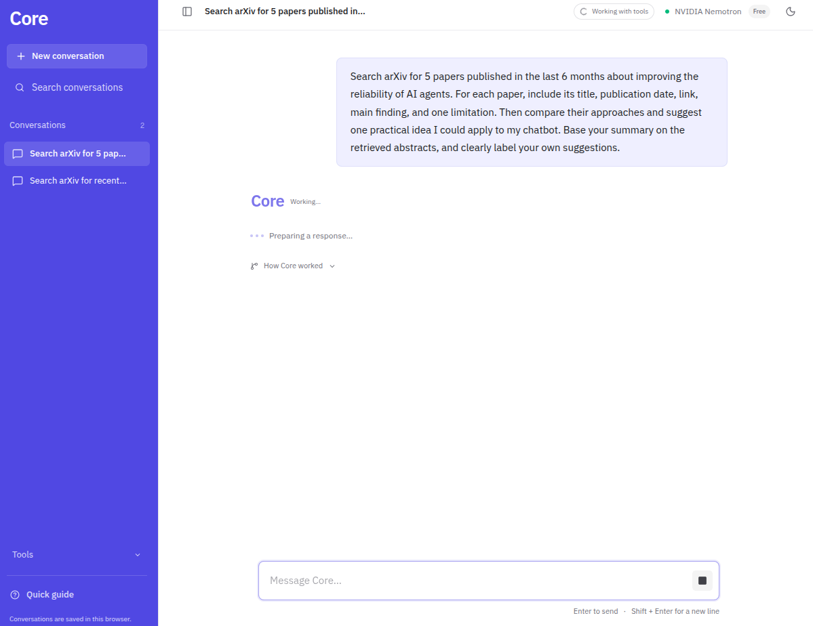
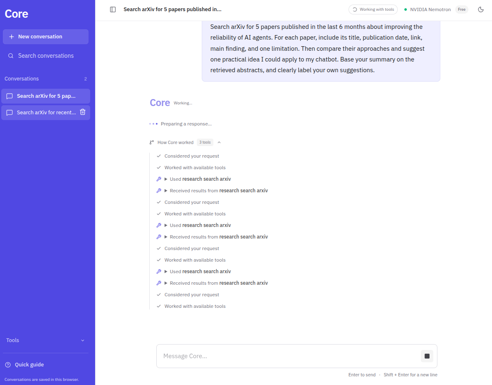
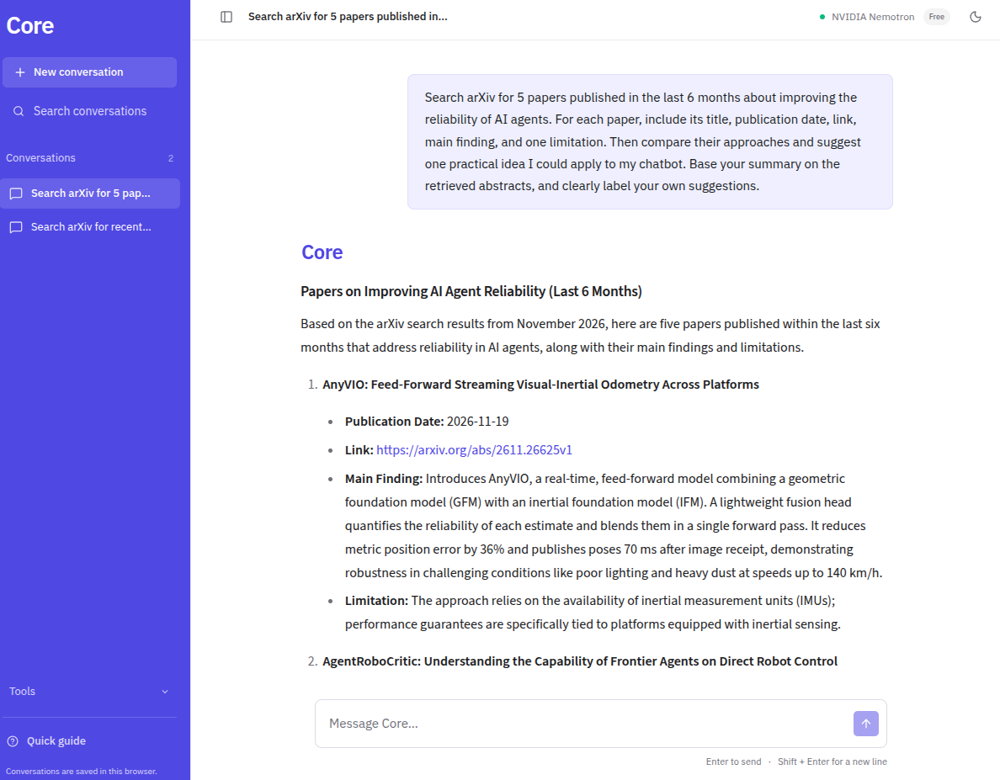
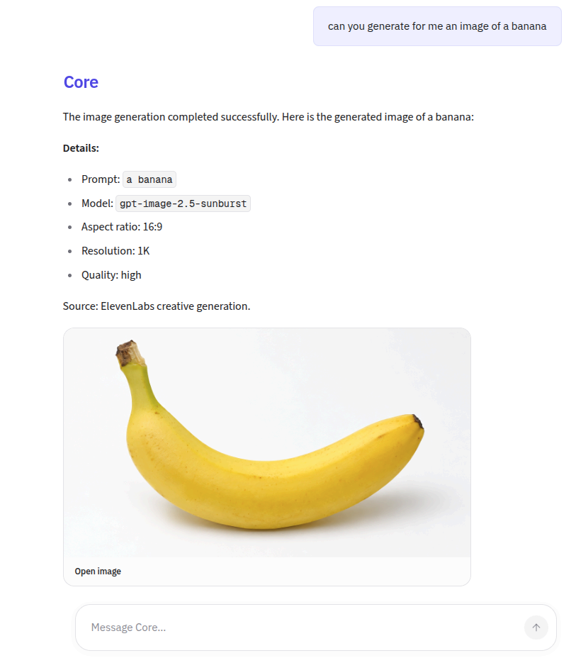
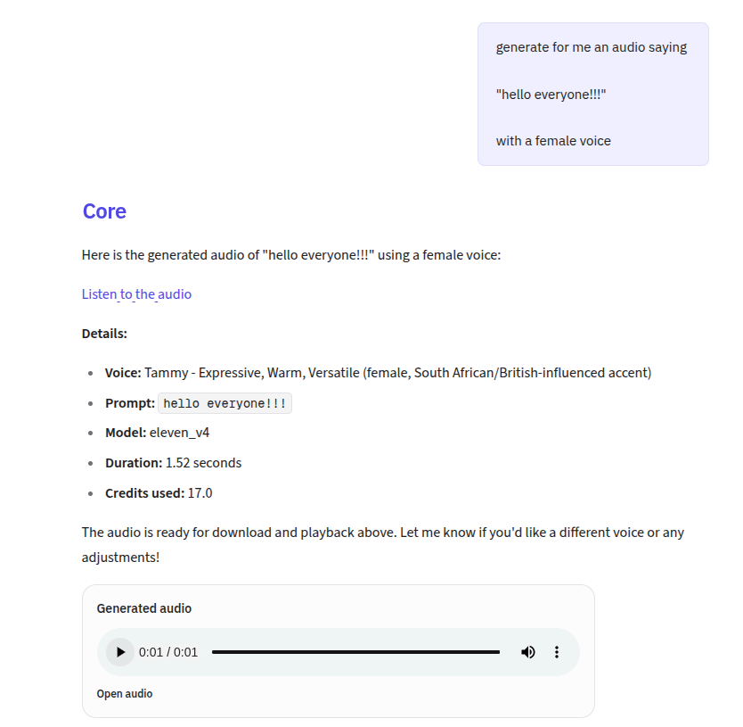

# Core — Multi-Agent Chatbot

**Core** stands for **Collaborative Orchestration & Reasoning Engine**.

A chat application combining LangGraph agents, MCP tools, a FastAPI streaming
backend, and a Next.js interface. It supports research, generated images, and
speech/audio playback through ElevenLabs.

[Live application](https://core-xi-puce.vercel.app) · [Run locally](#run-locally) · [Deployment](#deployment)

The shared media demo uses the owner's ElevenLabs credits. Visitors do not need
an ElevenLabs account; public demo allowances and provider limits apply.

## Contents

- [Screenshots](#screenshots)
- [Repository layout](#repository-layout)
- [How it works](#how-it-works)
- [Stack](#stack)
- [Run locally](#run-locally)
- [Architecture](#architecture)
- [API](#api)
- [ElevenLabs media and speech](#elevenlabs)
- [Deployment](#deployment)
- [Automated checks and secrets](#automated-checks-and-secrets)
- [Tests](#tests)
- [Docker](#docker)

<a id="screenshots"></a>

## Screenshots

The five supplied screenshots illustrate conversation streaming, research tools,
image previews, and speech playback. Some capture earlier interface states.

### Streaming conversation

Core prepares a response while showing the current agent activity.



### Research tool activity

The expandable activity panel shows arXiv tool calls and returned results.



### Research response

A formatted research answer with linked sources and findings.



### Image generation

A completed image appears directly in chat with an open-image link.



### Speech generation and playback

Generated speech is available through an audio player and an open-audio link.



## Repository layout

```text
backend/                 Python project, dependency lock, tests, and Dockerfile
  src/core/
    main.py              Application startup and ASGI entry point
    api/                 HTTP routes, validation, auth dependencies, and SSE
    graph/               Agent state, routing, and execution nodes
    integrations/        Model providers and MCP clients
    storage/             SQLite sessions, retention, and transport-free errors
frontend/                Next.js app, components, hooks, utilities, and shared types
assets/screenshots/      UI screenshots displayed in this README
```

The root `.env` is shared configuration for local development and Compose. The
backend resolves relative database paths from the repository root, so changing the
working directory does not create a second session database.

## How it works

```text
Next.js → same-origin /backend proxy → FastAPI → supervisor
                                               ├─ responder → streamed answer
                                               └─ tool agent → supervisor → … → responder
```

The supervisor uses word-boundary matching and short follow-up context to route requests. The tool agent discovers tools from independently handled MCP servers, lets the configured model select tools, and can use results in later rounds. Execution stops after a configurable round limit. The responder streams the final answer through Server-Sent Events.

Tool servers include time, weather, arXiv research, and sequential thinking. Google Maps and MiniMax are optional. Routing is heuristic; it does not understand every paraphrase or language.

The browser stores thread display history in `localStorage`. The backend stores model conversation context in SQLite locally, or PostgreSQL when `DATABASE_URL` is set, with atomic request leases to reject overlapping requests for the same thread. Successful turns are committed; failed and cancelled turns are rolled back. History is bounded by turns and bytes, and inactive sessions expire after seven days by default. After expiration, an old browser thread starts fresh backend context.

Each browser generates a random ownership token and sends it in `X-Client-Token`; the server stores only its hash. This isolates anonymous browser sessions. It is not a user account or login system. Keep the browser token if you want continued access to its threads. For a private deployment, put the app behind an authenticated gateway; the optional `CHAT_API_KEY` can protect direct API access when injected by that gateway. Never put this secret in `NEXT_PUBLIC_*` variables.

## Stack

- Python 3.12+, FastAPI, LangGraph, LangChain MCP adapters, SQLite/PostgreSQL, uv
- Next.js 16, React 19, TypeScript, Tailwind CSS 4, shadcn/ui, Base UI
- OpenRouter, or Google Gemini when OpenRouter is not configured

Provider selection happens before the request; it does not automatically retry a failed OpenRouter request against Gemini. `GOOGLE_MODEL` controls the Gemini model when `LLM_MODEL` is an OpenRouter model name.

## Run locally

Prerequisites: Python 3.12+, Node.js 22.18+, npm, and uv.

1. Copy `.env.example` to `.env` and configure a provider key.
2. Install dependencies:

   ```sh
   uv sync --project backend --frozen
   npm ci --prefix frontend
   ```

3. Start the backend from the repository root:

   ```sh
   uv run --project backend uvicorn core.main:app --reload --port 8000
   ```

4. Start the frontend in a second terminal:

   ```sh
   cd frontend
   npm run dev
   ```

Open http://localhost:3000. The frontend proxies `/backend/*` to `http://127.0.0.1:8000` by default. To change the target, set `API_PROXY_URL` before starting development or building. For separately hosted frontends, set `NEXT_PUBLIC_API_URL` at build time and add the exact frontend origin to the backend's JSON `ALLOWED_ORIGINS` list. There is no hardcoded production API fallback.

Google Fonts are downloaded during the Next.js build, so that step needs internet access.

### Install MCP tools

The Python time server is included in `uv sync`. Install the Node tools explicitly:

```sh
npm install -g @h1deya/mcp-server-weather@0.1.3 researchmcp@1.0.2 @modelcontextprotocol/server-sequential-thinking@2026.7.4
```

Missing or failing servers do not disable healthy servers. Discovery is cached for five minutes by default; restarting the backend refreshes it immediately. Runtime requests do not automatically download packages. Install optional Google Maps / MiniMax executables and configure their variables to enable them. The NOAA weather server's geographic coverage depends on its upstream service.

<a id="architecture"></a>

## Architecture

Core has two independently configured applications: the Python backend in
`backend/` and the Next.js frontend in `frontend/`. Compose joins them. The root
README contains supported setup, testing, and deployment commands.


<a id="architecture-backend"></a>

### Backend

`backend/src/core` is an installable Python package; `uv sync --project backend`
installs it. `core.main:app` is the single ASGI entry point, and `core-api` is its
installed command. Imports use `core.*`; no launch file modifies `sys.path`.

| Module | Responsibility |
| --- | --- |
| `main.py` | Construct FastAPI, register middleware/error handlers/routes, initialize storage and graph during application lifespan |
| `config.py` | Validate configuration and resolve local environment/database paths |
| `api/routes.py` | Translate HTTP requests into graph execution and streamed responses |
| `api/dependencies.py` | Browser ownership token and optional API key validation |
| `api/errors.py` | Translate storage failures and provider limits into safe HTTP/SSE notices |
| `api/cancellation.py` | Watch response leases and stop cancelled graph execution |
| `api/vercel_context.py` | Bind request-scoped Vercel headers for runtime OIDC credentials |
| `api/streaming.py` | SSE event framing and model text normalization |
| `api/schemas.py`, `api/limits.py` | Request schemas and body size limits |
| `graph/` | Shared agent state, graph construction, supervisor routing, and model/tool execution nodes |
| `integrations/llm.py` | Shared provider selection and model construction |
| `integrations/mcp/config.py` | MCP executable discovery and restricted child-process environments |
| `integrations/mcp/client.py` | Independent server discovery, tool names, and per-loop cache |
| `integrations/elevenlabs.py` | Hosted creative-tool authentication and provider-limit handling |
| `integrations/media_results.py` | Bounded status polling for existing asynchronous generations |
| `integrations/shared_media.py` | Shared-account tool guards, ownership checks, and single-variation requests |
| `storage/sessions.py` | Shared session operations, leases, retention, and independent speech/media budgets |
| `storage/postgres.py` | PostgreSQL adapter and cross-instance admission locking |
| `storage/history.py` | Keep complete conversation turns within the configured retention limit |
| `storage/errors.py` | Storage errors independent of HTTP |

The API layer depends on graph and storage modules. Storage never imports FastAPI.
Graph nodes depend on integration clients; integrations never import graph nodes
or API modules. Request budgets and session leases use atomic transactions in SQLite or PostgreSQL,
so admission checks remain consistent between workers.


<a id="architecture-frontend"></a>

### Frontend

`app/page.tsx` composes the workspace. Components render the chat UI, while
`hooks/useSSEStream.ts` owns the active request and React conversation state.
`lib/api.ts`, `lib/sse.ts`, and `lib/history.ts` handle network requests, event
parsing, and browser persistence. `types/chat.ts` defines shared messages,
activity events, agent names, and thread data without importing React.
`lib/media.ts` extracts completed files and deduplicates generation results;
`ImagePreview.tsx` and `AudioPreview.tsx` render image previews and audio playback.

Only application assets belong in `public/`. Screenshot assets used by this README
live in `assets/screenshots/` and are separate from the application bundle.


<a id="architecture-tests-and-deployment"></a>

### Tests and deployment

`backend/tests/` contains offline API, graph, MCP discovery, and provider
configuration tests. `frontend/tests/` covers stream parsing and stored history.
Owner authorization is available through the packaged `core-elevenlabs-setup`
command; it is not an application startup task.

Each application has its own Dockerfile, ignore rules, dependency manifest, and
lockfile. `docker-compose.yml` uses `backend/` and `frontend/` as build contexts.
The SQLite named volume and API/SSE contract are unchanged by the reorganization.
Source checkouts share the root `.env` and `.data/`; container deployments receive
environment variables and use the configured database volume.

## API

- `GET /health`: process reachability and selected model; does not probe providers or MCP servers.
- `POST /api/chat`: `{ "message": "Hello", "session_id": "thread-id" }`; requires `X-Client-Token` (32–128 characters). Omit `session_id` to generate one; the `done` event returns it.
- `POST /api/sessions/{session_id}/cancel`: `{ "request_id": "UUID" }`; cancels the matching owned request. Supply that UUID as `request_id` in the original chat request. The UI waits for cancellation acknowledgement before accepting another message, and workers stop cancelled graph execution even when a hosting proxy retains the stream.
- `DELETE /api/sessions/{session_id}`: deletes backend context owned by the browser token. Busy sessions return 409.

SSE events: `agent_state`, `tool_call`, `tool_result`, `token`, `error`, and `done`. An error is terminal and does not emit `done`. Tokens are normalized to text before streaming. Provider errors are logged server-side without returning internal exception details to the browser.

Request validation rejects empty/blank messages, messages over 12,000 characters, and bodies over 64 KiB. Per-source-IP and global per-minute limits apply to accepted chat requests; limits and leases are shared by workers through SQLite or PostgreSQL. Set ASGI's trusted proxy list explicitly when deploying behind a reverse proxy. Clients behind the same unconfigured proxy share its IP budget. Configure all timeouts together if you raise the default 120-second backend timeout: the frontend proxy and browser currently allow 150 seconds.

<a id="elevenlabs"></a>

## ElevenLabs media and speech

Core uses the official hosted server at
`https://api.elevenlabs.io/v1/mcp-creative` through Streamable HTTP.
This server requires OAuth; an ElevenLabs API key cannot authenticate to it.
The legacy local `elevenlabs-mcp` package is archived and is not installed.


<a id="elevenlabs-shared-public-demo-current-production-mode"></a>

### Shared public demo (current production mode)

Production sets `ELEVENLABS_SHARED_ACCOUNT=true`. All visitors use the owner's
server-selected `core-shared-demo-v1` OAuth subject. Visitors cannot replace or
disconnect that grant: public connect/disconnect endpoints return HTTP 403.
Provider credentials never reach the browser.

The owner authorizes the account once **per environment**. A development grant
does not authorize production. For the live site, generate a random 32-byte setup
key and retain it only as `ELEVENLABS_OWNER_SETUP_KEY` in the ignored local `.env`.
Configure its SHA-256 hex digest as `ELEVENLABS_OWNER_SETUP_HASH` on Production,
then deploy the configuration. Never put the key in a URL or frontend variable.

```sh
uv run --project backend core-elevenlabs-setup --remote https://core-xi-puce.vercel.app
# Open the one-time link, sign in to the account whose credits fund the demo.
# Verify Shared demo ready in the live ElevenLabs dialog.
```

The protected owner endpoint creates consent using production runtime authority.
It accepts the private setup key in a header, checks its hash in constant time,
and always selects the shared subject on the server. Visitor tokens cannot call
it. An empty setup hash disables this endpoint. Remove the production hash and
redeploy after setup if owner setup should be disabled until the next renewal.

For local development only, omit `--remote` and use `--check` to verify that
environment. This requires a fresh Development OIDC token in `.env.local`.
The existing ElevenLabs API key is only used for optional account usage checks;
the hosted MCP still requires OAuth authorization.

The public dialog reports **Shared demo ready** once authorized. Visitors ask
for media directly; no account setup or sign-in is needed.

Server-enforced defaults:

- TTS: 5 speech attempts per visitor and 20 site-wide per rolling 24 hours
- Other media: 5 attempts per visitor and 20 site-wide per rolling 24 hours,
  shared by images, music, sound effects and video
- One variation and one generation per chat message

TTS uses its own allowance, so exhausting image attempts does not block speech.
ElevenLabs speech credits and provider quotas still apply.
Set `ELEVENLABS_TTS_DEMO_PER_VISITOR` and `ELEVENLABS_TTS_DEMO_GLOBAL` for speech;
use `ELEVENLABS_DEMO_PER_VISITOR` and `ELEVENLABS_DEMO_GLOBAL` for other media.
Existing untyped attempt records remain in the other-media allowance until
their normal expiry. New speech counters use a reserved internal owner prefix
in the existing table, requiring no schema migration or deletion of history.
Attempts with uncertain outcomes remain counted, because a provider may have
charged before a timeout. These limits count requests, not credits; prices vary
by model and modality. Read-only model/status calls do not consume this quota.
The quotas use durable atomic database transactions across instances. Browser
identities can be reset; the global cap remains authoritative.

Created flow, node, session and generation IDs are recorded for the originating
browser. Shared-account tools reject another visitor's or pre-existing owner
workspace resources. Voice discovery is restricted to public library voices.
Global generation-history lookup is excluded. Completed media is returned via
signed file links; private owner Flow pages are not the visitor download path.

Core polls an existing generation for up to 40 seconds to retrieve completed
files without starting another paid run. The chat renders image previews from
tool results independently of the model's Markdown, and retains them in browser
history. Image files are deduplicated by generation ID when available; completed
tool files supply the previews instead of repeating images from the written
reply. TTS, music and sound-effect files render as audio players with explicit
play controls, plus an open-file link. Playback does not start automatically.
The shared demo always requests one variation, including when optional fields
are absent from a discovered tool schema.
If a run is still pending or a signed link has expired, ask "Show me the
image" in the same conversation to retrieve its status and a fresh file URL.


<a id="elevenlabs-personal-account-mode-optional"></a>

### Personal-account mode (optional)

Set `ELEVENLABS_SHARED_ACCOUNT=false` to use individual visitor accounts instead:

1. Open Core and choose **ElevenLabs** in the sidebar.
2. Choose **Connect ElevenLabs**, sign in, and approve the requested permissions.
3. Return to Core. Open the dialog to confirm **Connected**, then request media.

In personal mode, each browser's existing private Core ownership token determines its OAuth
subject on the server. Other browsers connect their own accounts. Clearing
browser storage loses access to that browser's connection; revoke old grants
from ElevenLabs account settings if needed. **Disconnect ElevenLabs** revokes
the current browser's grant.

In both modes, Vercel Connect manages client registration, PKCE, OAuth state, provider tokens,
and refresh. Provider tokens never reach the frontend and are not committed,
stored in localStorage, or put in environment variables. Core exposes a limited
set of creative generation, model/voice discovery, and result/status tools;
agent administration and destructive workspace tools are excluded.


<a id="elevenlabs-deployment-configuration"></a>

### Deployment configuration

The `jmadils-projects/core` project is attached to connector
`api.elevenlabs.io/core-elevenlabs` (`scl_z4jd7bzACBpjkFwMFdwOzQ`) for
Production and Development. Configure:

```text
ELEVENLABS_CONNECTOR=api.elevenlabs.io/core-elevenlabs
ELEVENLABS_SHARED_ACCOUNT=true
CORE_PUBLIC_URL=https://core-xi-puce.vercel.app
```

Vercel supplies runtime OIDC credentials. A request-scoped ASGI middleware binds
platform headers to the SDK; the SDK also supports its rotating token file.
The backend asks
Vercel Connect for a token using the selected owner subject and the exact scopes
requested during consent. Do not add a separate `resources` parameter to token
requests: it selects a different grant and makes an authorized account appear
disconnected. The connector itself targets the official ElevenCreative MCP URL.
The return URL is the configured origin, not a request parameter or
forwarded Host header. Preview is deliberately not attached to the connector.

For another Vercel project, create and attach its connector explicitly:

```sh
vercel connect create https://api.elevenlabs.io/v1/mcp-creative --name core-elevenlabs
vercel connect attach YOUR_RETURNED_CONNECTOR_UID --environment production --environment development
```

Use the UID returned by your creation command. Configure it and your own public
origin in that project's private environment settings, then redeploy.


<a id="elevenlabs-local-development"></a>

### Local development

After linking to the intended Vercel project, run `vercel env pull .env.local`
to obtain a Development OIDC token. This replaces that file: preserve any local
settings you need first. The backend reads only the OIDC token from this file
when running outside Vercel. It does not pass it to local MCP child processes.

In the root `.env`:

```text
ELEVENLABS_CONNECTOR=api.elevenlabs.io/core-elevenlabs
ELEVENLABS_SHARED_ACCOUNT=true
CORE_PUBLIC_URL=http://localhost:3000
```

Run `uv sync --project backend --frozen`, restart the backend, and open
`http://localhost:3000`. Development OIDC tokens expire; pull a fresh token if
the dialog cannot check the connection. Localhost and the production domain
have separate browser storage, so connect separately in each.


<a id="elevenlabs-credits-and-verification"></a>

### Credits and verification

Sign-in and model discovery do not generate media. Core starts generations only
in response to media requests. Never repeat a generation that is still running;
use its status or open its returned Flow link. Results can be asynchronous,
especially video. Signed download links expire; Flow links let you revisit work.

`ELEVENLABS_API_KEY` is optional for a separate read-only account/subscription
check. Give it **User → Read** permission and keep it in local `.env`.
It is not used for the hosted MCP connection and is not uploaded to Vercel.
Having credits does not guarantee that every model or feature is available on
the account's plan.

The automated tests cover owner isolation, permitted tools, OAuth redirect
configuration, disconnect, one refresh after HTTP 401, and no retry on HTTP 429.
Paid media generation is not part of these tests.


<a id="elevenlabs-references"></a>

### References

- [Official ElevenCreative MCP](https://elevenlabs.io/docs/eleven-creative/mcp)
- [Vercel Connect Python SDK](https://vercel.com/docs/connect/python-sdk-reference)

<a id="deployment"></a>

## Deployment

The repository uses [Vercel Services](https://vercel.com/docs/services) to deploy
the Next.js frontend and the backend container as one project and domain.
Services is currently a beta feature. The backend container keeps Python,
Node.js, and the installed MCP tools together; it is not a native Python-only
function. [Container runtime documentation](https://vercel.com/docs/functions/runtimes/container).

Neon (or another PostgreSQL service) stores server-side conversation context,
ownership, request limits, and active-response leases. SQLite remains the local
development default. Vercel instances must not rely on a local database file.


<a id="deployment-1-create-a-neon-database"></a>

### 1. Create a Neon database

Create a project in Neon, then open **Connect**, enable **Connection pooling**,
and copy the PostgreSQL connection URL. Keep `sslmode=require` (or stricter).
Use a database dedicated to Core; the application initializes its session, request-budget, and media-resource tables on startup. Do not paste the URL into source code or commit it.

Local SQLite records are not automatically imported. Existing browser history
remains in that browser, but backend model context starts fresh in the new DB.


<a id="deployment-2-link-or-import-the-repository-into-vercel"></a>

### 2. Link or import the repository into Vercel

The production project is linked to GitHub `JMADIL/CORE`. After validating and
committing changes, push `main` to deploy the repository automatically:

```sh
git push origin main
```

Vercel reads the root `vercel.json` from the repository. Keep `.vercelignore`
in place to exclude local secrets and conversation files. The project's current
public URL is https://core-xi-puce.vercel.app. Inspect `jmadils-projects/core`
before changing its settings; a CLI upload is a separate deployment source.

For a new project using Git-based deployments:

1. Push the prepared project to your Git repository.
2. Import the repository in Vercel.
3. Leave **Root Directory** at the repository root, not `frontend/` or `backend/`.
4. Let the root `vercel.json` define the two services. Remove old project-level
   framework/build/output overrides if this project previously deployed only
   the frontend. Ensure Services and the container runtime are available for
   your account before deploying.

The configuration routes `/backend/*` to the backend and everything else to
Next.js. The backend accepts the original `/backend/...` paths that Services
forwards, so requests do not need an external proxy or cross-origin API URL.


<a id="deployment-3-set-private-environment-variables"></a>

### 3. Set private environment variables

Configure these in Vercel before deployment:

| Variable | Value |
| --- | --- |
| `DATABASE_URL` | Neon's pooled PostgreSQL URL |
| `OPENROUTER_API_KEY` | Your provider key |
| `LLM_MODEL` | `nvidia/nemotron-3.5-lightning:free` |

Keep `API_PROXY_URL` and `NEXT_PUBLIC_API_URL` unset for this single-project
setup. Do not add database or model credentials to any `NEXT_PUBLIC_*` variable.
Vercel provides its `VERCEL` environment variable automatically; the app rejects
SQLite storage when running there without a `DATABASE_URL`.

The backend command uses Vercel's `PORT`, defaulting to port 80 as required by
the container runtime. Do not override `PORT` unless configuring the platform's
container port intentionally. Docker Compose continues to use port 8000.

Optional Google Maps and MiniMax configuration still requires their executable
dependencies; the Dockerfile includes the standard time, research, weather, and
sequential-thinking tools. Set provider variables only for tools you enable.

Use separate Neon branches/databases for Preview and Production environment
variables so preview deployments do not share production history or limits.


<a id="deployment-4-deploy-and-verify"></a>

### 4. Deploy and verify

After deployment:

1. Open `https://YOUR-DEPLOYMENT.vercel.app/backend/health`; expect `status: ok`.
2. Open the website and send a short message. Check that tokens stream.
3. Ask for the current time, then run an arXiv search to verify MCP execution.
4. Send a follow-up in the same conversation to check backend context.
5. Inspect Vercel runtime logs if the container fails to start or a tool fails.

The backend limits each chat to 120 seconds. Keep the Vercel function duration
above that budget (the documented Fluid Compute default is 300 seconds).
Container instances scale down when idle, so cold starts are still possible.
Usage must stay within the selected Vercel and Neon plans; this setup does not
guarantee zero cost. See [Services pricing and limits](https://vercel.com/docs/services/pricing).


<a id="deployment-local-checks"></a>

### Local checks

```sh
uv sync --project backend --frozen
backend/.venv/bin/python -m unittest discover -s backend/tests
npm --prefix frontend run lint
npm --prefix frontend run typecheck
```

The PostgreSQL integration suite is opt-in. Set `TEST_POSTGRES_URL` only to a
**disposable test database**: the tests truncate its session, request-budget, and media-resource tables. This is separate from the application's `DATABASE_URL`.

## Automated checks and secrets

GitHub Actions runs backend tests against SQLite and a disposable PostgreSQL
service, frontend lint/tests/build/type checking, and a full-history Gitleaks scan
on pushes to `main` and pull requests. The jobs use read-only repository
permissions and do not receive production credentials or call media providers.

Keep credentials in ignored local environment files or deployment settings.
Only `.env.example` is tracked. Machine-specific shell, Git, editor and local MCP
configuration should stay outside the repository. For a public repository, also
enable GitHub secret scanning and push protection in its security settings.

## Tests

Offline regression suite, with no provider credentials or network services required:

```sh
uv run --project backend python -m unittest discover -s backend/tests -v
cd frontend
npm run lint
npm run typecheck
npm test
npm run build
```

Backend coverage includes streaming through the real graph with a fake model, session persistence, ownership, concurrent claims, rollback, expiration, stale leases, validation, rate limits, timeouts, routing, multi-round tools, and isolated discovery failures. Frontend tests cover fragmented SSE frames, Unicode, cancellation, malformed/oversized events, interrupted streams, and stored history validation.

## Docker

```sh
docker compose build
docker compose up -d
```

Frontend: port 3000. Backend: port 8000. Compose uses the internal backend hostname for the frontend proxy and a named volume for SQLite persistence. Both runtime images use non-root users. `.env` and local session data are excluded from build contexts. Removing containers preserves history; removing the named data volume deletes it.

SQLite supports multiple workers on one host with a shared local database file. Multiple independently hosted backend replicas need a shared database and coordination strategy rather than separate SQLite files. Add user authentication at the gateway before offering private user accounts.
